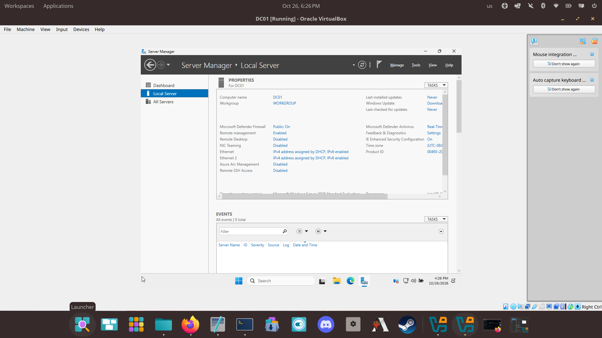

# 01 - Environment Setup

## Goal
Get VirtualBox installed on the host and create the VM for the domain controller.

## Host
- OS: Pop!_OS
- RAM / disk: _fill in_
- Virtualization enabled (VT-x / AMD-V): _yes/no_

## Steps I took
1. Installed VirtualBox (`sudo apt install virtualbox`) and added my user to the `vboxusers` group.
2. Downloaded the Windows Server evaluation ISO and Windows 11 Enterprise evaluation ISO from the Microsoft Evaluation Center.
3. Created VM `DC01`: _RAM_, _CPUs_, 50 GB disk, "Skip Unattended Installation" ticked.
4. Network: Adapter 1 = NAT (internet), Adapter 2 = Internal Network `labnet`.

## Why these choices
- NAT adapter: lets the VM reach the internet for updates and activation.
- Internal network: a private network only my lab VMs share, like a small office LAN.

## Screenshots
- 
- 
- 

## Problems hit
See [troubleshooting-log.md](troubleshooting-log.md).
