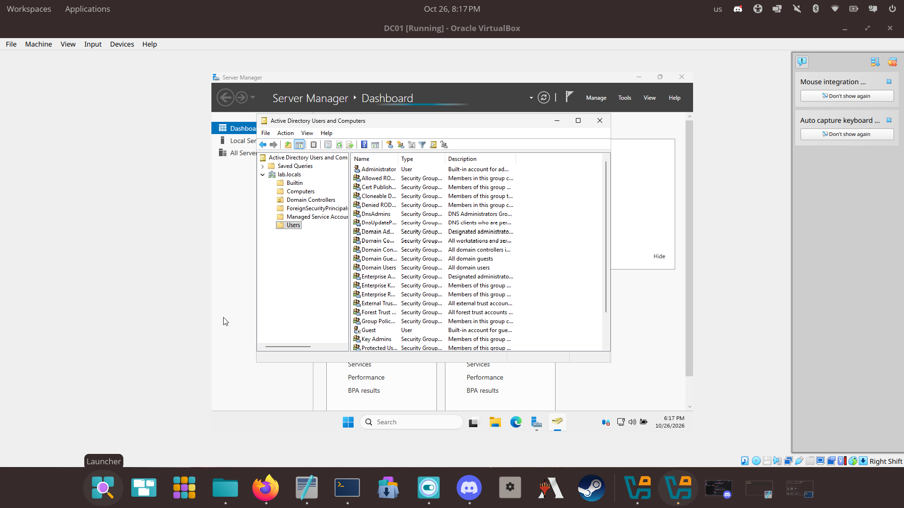

# 02 - Domain Controller

## Goal
Install Windows Server, give it a static IP, and promote it to a domain controller for `lab.local`.

## Steps I took
1. Installed Windows Server (Desktop Experience), set an Administrator password.
2. Renamed the server to `DC01`.
3. Set a static IP on the `labnet` adapter: IP `192.168.10.10`, mask `255.255.255.0`, DNS `127.0.0.1`.
4. Installed the **Active Directory Domain Services** role (plus DNS).
5. Promoted the server: **Add a new forest**, root domain `lab.local`, set the DSRM password.
6. Server restarted; logged in as `LAB\Administrator`.

## Why it matters
- A domain controller keeps the list of users, computers, and policies for the whole network.
- DNS must work or clients cannot find the domain. Many AD problems are really DNS problems.

## Plain-English notes (in my own words)
- Domain: _..._
- Forest: _..._
- DNS: _..._

## Verification
- 
