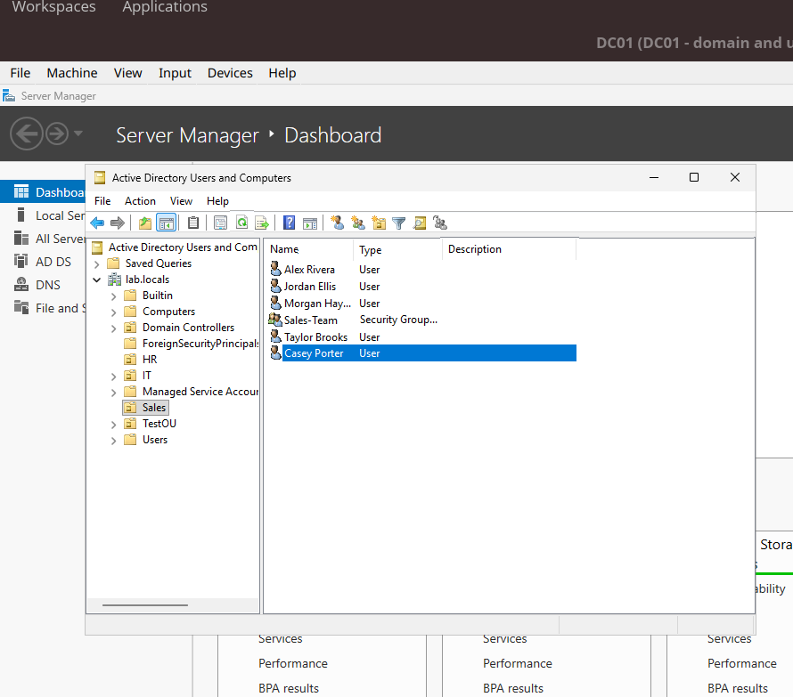
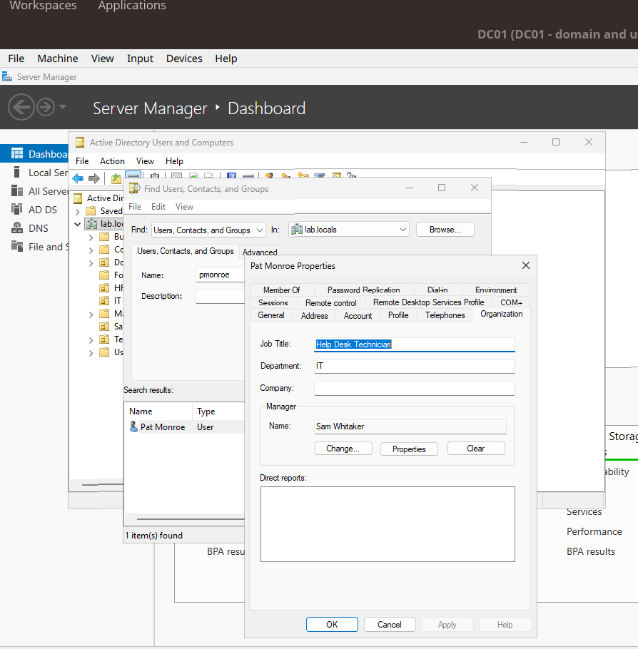

# 03 - Users, Groups, and OUs

## Goal
Model a small company: departments as OUs, employees as users, and access through security groups.

## Structure
```
lab.local
├── Sales
├── HR
└── IT
```

## Steps I took
1. Created OUs: Sales, HR, IT.
2. Created users (manually first, then with the script in `scripts/`).
3. Filled in attributes: title, department, phone, email, manager.
4. Created security groups: `Sales-Team`, `HR-Team`, `IT-Admins`.
5. Added users to groups.

## Everyday tasks I practiced
- [ ] Reset a user's password
- [ ] Unlock a locked-out account
- [ ] Disable an account (employee leaves)
- [ ] Move a user to a different OU
- [ ] Add/remove a user from a group

## Why groups, not individual permissions
_Explain in your own words. (Hint: when someone changes roles, you change one group membership instead of touching every folder.)_

## Screenshots
- 
- 
